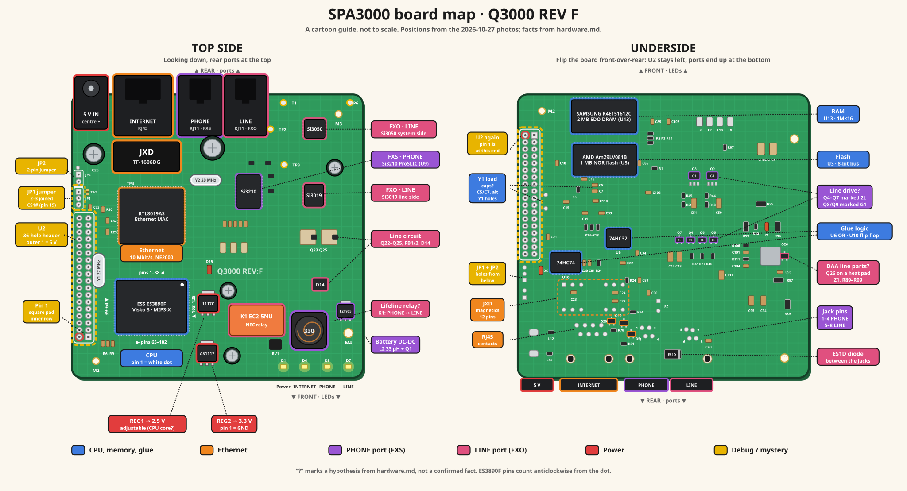

# SPA3000 hardware

Status: draft, from photos of both sides of one board and the case
(2026-10-27) and close-ups (2026-10-29), continuity tests on the unpowered board (2026-10-28), and DC
voltages on the powered board running the stock firmware (2026-10-28). Clean-side document: chip markings and public datasheets
only. See [`../clean-room.md`](../clean-room.md) for the process.

Each fact is marked:

- **Read**: printed on the part, board or case and legible in the photos.
- **Datasheet**: from the manufacturer's public datasheet for that part.
- **Public source**: from public open-source code or documentation about
  a related device (§2.6). True of that device; to be checked on this one.
- **Measured**: tested on the board with a multimeter (continuity or
  diode test, unpowered unless stated).
- **Hypothesis**: inferred from placement or typical use; not confirmed.

Photos are in [`photos/`](photos/):

| File | Shows |
|---|---|
| `20261027-SPA3000-Board-Top.jpg` | Whole top side, in the case |
| `20261027-SPA3000-Board-Underside.jpg` | Whole underside: flash, RAM, glue logic |
| `20261027-SPA3000-Board-Telephony-Closeup.jpg` | Si3210 and DAA area |
| `20261027-SPA3000-DAA-Closeup.jpg` | Si3050, Si3019 and test points |
| `20261027-SPA3000-Power-Relay-Closeup.jpg` | Relay, regulators, inductor, LEDs |
| `20261027-SPA3000-U2-Y1-Closeup.jpg` | U2 footprint and CPU crystal |
| `20261027-SPA3000-Case-Rear-Labels.jpg` | Port labels on the case |
| `20261027-SPA3000-CPU-Ethernet-Closeup.jpg` | ES3890F, RTL8019AS and the Y2 marking |
| `20261027-SPA3000-Inductor-Bridge-Closeup.jpg` | L2, Q1, bridge D14 and the LEDs |
| `20261027-SPA3000-Regulators-Closeup.jpg` | REG1, REG2 and relay K1 |
| `20261029-SPA3000-JP1-JP2-Edge-Closeup.jpg` | Board edge between the power jack and U2: C25, JP1/JP2, the three-hole footprint, `TWS` |
| `20261029-SPA3000-Underside-Rear-Closeup.jpg` | Underside, rear half: RJ11 jack pins, D2, Q19/Q20, the transistor rows |
| `20261029-SPA3000-Underside-Glue-Logic-Closeup.jpg` | Underside: U13, U3, U6, U10 and the parts around them |
| `20261029-SPA3000-Underside-DAA-Closeup.jpg` | Underside, right side: L7–L10, Q4–Q9, Q26, Z1 and the large resistors |

A cartoon map of both sides, drawn from these photos, for finding parts.
Positions are approximate. Source:
[`20261029-SPA3000-Board-Map.svg`](20261029-SPA3000-Board-Map.svg) (a
PNG copy is beside it).

Public datasheets used:

| Part | Document | Where |
|---|---|---|
| ES3890 | ESS Technology, *ES3890 Video CD Processor Product Brief*, SAM0487-031704, 6 pages. Pinout and pin description only; no registers, memory map or timing. No full datasheet has been found in public. | HTML copy at alldatasheet.com (`/html-pdf/126592/ETC1/ES3890F/`); PDF at insidegadgets.com (`/wp-content/uploads/2018/03/ES3890F.pdf`), behind a browser check |

Public source code used:

| Project | Files | Where |
|---|---|---|
| MAME (BSD-3-Clause) | `src/mame/skeleton/pap2.cpp` (Linksys PAP2 machine, by Joseph Khilfeh, added in pull request 12726, September 2024) and `src/devices/cpu/mipsx/mipsx.cpp` (MIPS-X CPU skeleton, by David Haywood) | github.com/mamedev/mame, master branch, read 2026-10-27 |

## 1. Board and case

| Item | Value | Status |
|---|---|---|
| Board name | `Q3000 REV F` | Read |
| PCB flammability rating | 94V-0, maker's mark "TJ-1" | Read |
| Versions reported by the stock web UI (Info page, 2026-10-28) | Software 3.1.20(GW), the version the format spec was written from; hardware 3.3.1(1448); client certificate installed; customization Open (not provider-locked) | Observed |
| Enclosure | Two-part grey plastic case. The board is held by screws through mounting holes (M2 at the lower-left corner, and one at the left edge). | Read (from photos) |
| Power input | DC 5 V, centre positive | Read (case label and polarity symbol) |
| Rear ports, left to right seen from behind | LINE (RJ11, FXO), PHONE (RJ11, FXS), INTERNET (RJ45), power jack | Read (case label) |
| Rear ports, left to right seen from above with the ports at the top | Power jack, RJ45, PHONE, LINE. LINE is the outer RJ11, next to the Si3050/Si3019 corner of the board. | Read |
| LEDs | Surface-mount, along the front edge of the top side: D1, D4, D7, D8 | Read |
| Front panel | Four light windows, left to right seen from the front: Power (⏻ symbol), INTERNET, PHONE, LINE | Read (case label) |
| LED positions | Left to right seen from the front: D1 (Power), D4 (INTERNET), D8 (PHONE), D7 (LINE). R20 sits beside D1 and R79 beside D4; D8 and D7 have no resistor beside them. | Read (from a photo with the board above the case) |
| LED wiring | D4, D7 and D8 share one trace on their board-edge side, which is their anode side; with the board unpowered, diode-testing any one of them lights all three at about 1.8 V. D1 (Power) is not on that trace: it reads 1.2 V one way and 0.9 V the other and does not light, so something conducts in parallel with it. | Measured |
| Test points | TP2, TP3, TP6 and T1 are plated holes. TP4's label is above the top-left corner of the RTL8019AS, with no hole beside it; not yet probed. A small pad labelled `TWS` (the name of ES3890F pin 59, §2.5) is below TP4, beside C73. | Read |
| Edge footprints between the power jack and U2 | Along the left board edge, going from the power jack towards U2: C25 (the large electrolytic), a single plated hole beside C25's label, a two-hole footprint in one silkscreen box labelled JP2 (square pad) and JP1, then an unpopulated three-hole footprint, and then U2. The three-hole footprint has its own silkscreen box with a thick bar beside its square pad, which is at the JP1 end (pin 1 by the usual convention). No label is visible for it. The `TWS` pad sits just inboard of where JP1 and the three-hole footprint meet; C73, R80, C32 and R23 sit between there and the RTL8019AS. | Read (close-up, 2026-10-29) |
| Test point voltages, powered and idle (no call), to REG2 pin 1 | TP2 0.11 V, TP3 0.95 V, TP6 0 V, T1 0 V, all steady. TP2 and T1 are beside the LINE jack, TP3 beside the Si3210 and TP6 beside the Si3050. None sits at a logic-high level, so none looks like an idle serial transmit line; TP2 and TP3 look like analog nodes in the line circuits. `TWS` pad 2.46 V, steady: held high, not a running word-select clock (which would average about half the rail). | Measured (powered); roles Hypothesis |

## 2. Main components

### 2.1 Processor, memory and glue logic

| Ref | Marking | Part | Role | Status |
|---|---|---|---|---|
| — | ESS `Visba3` `ES3890F` `F075` | ESS Technology ES3890F, a dual 32-bit RISC media processor sold for Video CD players; 128-pin PQFP. Pins in §2.5. | Main CPU. Runs the MIPS-X code described in the firmware spec. | Read; package Datasheet |
| Y1 | `TXC 27.0…` | 27.0 MHz crystal (TXC), HC-49/US can with its leads formed onto surface pads. Two unused plated holes about 4.9 mm apart on the underside, under Y1, look like an alternative through-hole HC-49 footprint; seen from below they sit just inboard of U2's inner row, level with roughly its 8th to 10th positions from pin 1 (Read, 2026-10-29). | CPU clock. 27 MHz is the standard reference for video SoCs of this kind. Routing: two traces run from Y1 to vias, cross to the underside, and come back up through two more vias with short traces to ES3890F pins 30 and 31 (XIN, XOUT; §2.5); each end of Y1 has continuity to one of them (Measured). Hypothesis: the underside part of the path goes through the load capacitors, probably C5 and C7 (a matched pair stacked just below the flash on the underside, C5 nearer the flash, with C12 above them and R5 beside them; each has a trace to a via), and perhaps a feedback resistor. | Read; pins 30 and 31 Measured; parts Hypothesis |
| U3 (underside) | `AM29LV081B-90EC` `0331GBM J` `© 1997 AMD` | AMD Am29LV081B: 8 Mbit (1 MB) parallel NOR flash, 3 V, 8-bit data bus only, 90 ns, 40-pin TSOP, sixteen uniform 64 KB sectors | Program storage. A 775 KB upgrade image fits with room to spare. | Read; details Datasheet |
| U13 (underside) | `SAMSUNG` `022` `K4E151612C-TC60` (read from a magnified crop of the underside photo; an earlier reading of `K4S161622…` was wrong) | Samsung K4E151612C: EDO DRAM, not SDRAM. 1M × 16 (16 Mbit, 2 MB), 3.3 V, TSOP-II; -60 is a 60 ns access time. EDO has no clock: it is driven by RAS/CAS strobes, which matches the ES3890F's DRAM pins (CAS#, DRAS0/1#, DWE#, DOE#, no clock; §2.5). 10 row and 10 column bits on MA[9:0] address exactly 1M words. `022` is probably a year-and-week date code. | Main RAM. 2 MB matches the 0x001FFFF0 value in the firmware spec's packed-section header (§4.1), which looks like a stack pointer at the top of RAM. | Read; type, size and speed from Samsung's part numbering, Datasheet still to check; row/column split Hypothesis |
| U6 (underside) | ST `74HC32` | Quad 2-input OR gate | Glue logic. Hypothesis: combines bus strobes and chip selects for the Ethernet chip or flash. | Read; role Hypothesis |
| U10 (underside) | ST `74HC74` | Dual D flip-flop | Glue logic. Hypothesis: clock division or bus timing for the Ethernet chip. | Read; role Hypothesis |
| Around U6 and U10 (underside) | — | C20, C81 and R21 beside U10; R14–R18 between U10 and U6; C22 and C34 beside U6; C21 between U2 and U10; D6, a small glass diode, next to the rear end of U2. | Decoupling and pull-ups for the glue logic, by placement | Read (close-up, 2026-10-29); roles Hypothesis |
| U2 | Unpopulated footprint: two rows of 18 plated, tinned holes (36 in all). Pitch 2.54 mm, scaled from the HC-49/US body of Y1 (17 pitches = 43.2 mm). Pin 1 is the square pad at the top-row end nearest R6 and the M2 mounting hole. On the top side, a fan of about 15 parallel traces runs straight from the ES3890F's nearer pin row into the U2 pads, with no series resistors; a few more go to the R6–R9 group (R7 and R8 marked `472`, 4.7 kΩ; R9 marked `201`, 200 Ω). On the underside, the flash's bus traces run past U2 towards the CPU and do not visibly enter its pads. The ES3890F edge that faces U2 is pins 39–64 (§2.5). | — | U2 carries the 5 V input, so it is a connector, not an alternative memory footprint (Measured, see below). Hypothesis: a development port wired straight to ES3890F pins 39–64: address lines, the CD-ROM serial input and the audio serial output (§2.5). The general-purpose AUX pins are mostly on the far edge, so a serial console, if any, is less likely to be on U2 than first thought. Inner layers cannot be seen. Powered and idle, to REG2 pin 1, numbering each row 1–18 from the square-pad end (the square pad is inner 1; the inner row is nearer the CPU): inner 1 0.2 V and changing (an active signal, mostly low); inner 2 3.05 V steady (probably pulled up); outer 1 4.9 V steady (the 5 V input); outer 2 0.13 V steady. Positions 3–18 of both rows not yet measured. | Read (from photos); 5 V pin and voltages Measured (powered); role Hypothesis |

### 2.2 Ethernet

| Ref | Marking | Part | Role | Status |
|---|---|---|---|---|
| — | Realtek `RTL8019AS` `7526954` `L721F TAIWAN` | Realtek RTL8019AS | Ethernet controller: 10 Mbit/s only, NE2000-compatible register set, ISA-style 8/16-bit bus, 100-pin PQFP | Read; role Datasheet |
| Y2 | `20R000` | 20.000 MHz crystal | RTL8019AS reference clock (the datasheet calls for 20 MHz) | Read |
| — | `JXD 1531H` `TF-1606DG` | JXD TF-1606DG | 10Base-T magnetics (isolation transformers and filters) between the RTL8019AS and the RJ45 | Read; role Hypothesis |
| — (underside, in front of the RJ45) | — | Two rows of six through-hole pins, each row in two groups of three, with one square pad at the U2 end of the row nearer the front. C23, C24 and C72 sit between the rows. | Hypothesis: the JXD TF-1606DG's pins, from their position under it | Read (close-up, 2026-10-29); identity Hypothesis |
| — (underside, behind the INTERNET jack) | — | Eight pins in two staggered rows of four | The RJ45's contacts | Read (close-up, 2026-10-29) |
| Q19, Q20 (underside) | — | Two SOT-23 transistors between the JXD pins and the PHONE jack pins, with R78, R81, R84 and D5 beside them | Unknown | Read (close-up, 2026-10-29) |

### 2.3 Telephony

| Ref | Marking | Part | Role | Status |
|---|---|---|---|---|
| U9 | `Si3210-KT` `0407ECCAAA` `PHILIPPINES` | Silicon Labs Si3210 ProSLIC | PHONE (FXS) port: line feed, ringing, codec and DTMF detection, plus a controller for an external DC-DC converter that makes the line battery voltage. PCM bus for audio, SPI for control. | Read; role Datasheet |
| U11 | `Si3050-KT` | Silicon Labs Si3050, system-side DAA | LINE (FXO) port, processor side: PCM and SPI to the processor | Read |
| U12 | `3019-FT` `0638FF` `FA09` | Silicon Labs Si3019, line-side DAA | LINE (FXO) port, line side. Linked to the Si3050 through Silicon Labs' capacitive isolation barrier. | Read |
| D14 | 4-pin SMD bridge rectifier, marking not legible | Diode bridge | Hypothesis: the polarity bridge in the Si3019's line circuit, so the DAA works whichever way round tip and ring are wired | Read (designator); role Hypothesis |
| Q22–Q25, FB1, FB2, RV1 | Transistors with large copper pads, ferrite beads and a surge protector, all beside the Si3019 | — | Hypothesis: the rest of the Si3019's external line circuit (hookswitch transistors, EMI filtering and surge protection) | Hypothesis |
| K1 | `EC2-5NU` `NEC` `JAPAN` | NEC EC2-5NU: DPDT signal relay with a 5 V coil, non-latching | Hypothesis: the power-fail or lifeline relay. Its two poles would switch tip and ring so that PHONE connects straight to LINE when the unit is off or the relay is released. | Read; role Hypothesis |
| L2 with Q1 | L2 `330`; Q1 `FZT955` | 33 µH power inductor; Q1 is a Zetex FZT955 high-voltage PNP transistor (SOT-223) | Hypothesis, strongly supported: the Si3210's DC-DC converter, which makes the negative line battery voltage. A high-voltage PNP switch plus an inductor is the usual way to build it. | Read; role Hypothesis |
| Q2–Q9 (both sides) | Small transistors near the Si3210. On the underside, Q4–Q7 are a row of SOT-23 parts marked `2L`, in the order Q7, Q4, Q6, Q5 going away from U6, with R38, R27, R40, C42 and C43 below them. Q8 and Q9 are larger three-legged parts marked `G1`, each with a row of three unused pads beside it, beside the flash on the side away from U2, behind L7–L10. | `2L` is the SOT-23 marking commonly used for the MMBT5401, a high-voltage PNP transistor; `G1` is not identified | Hypothesis: the Si3210's line-drive transistors | Read (underside close-ups, 2026-10-29); part from the marking Hypothesis; role Hypothesis |
| L7–L10 (underside) | — | Four two-terminal parts in a row, in the order L8, L7, L10, L9, towards the front edge, with R87 beside them. C102 and C103, two larger capacitors, sit beyond them on the side away from U2. | Unknown | Read (close-up, 2026-10-29) |
| Q26, Z1 and the large resistors (underside) | Q26: SOT-23 beside a large bare copper pad. Z1: glass diode. R97 marked `1071` (1.07 kΩ); R89 marked `000` (0 Ω). | — | Hypothesis: more of the Si3019's line-side circuit, from their position under the DAA. Also on that side: R90, R94, R95, R99, R106, R111, C94, C95, C98, C101, C104 and C111. | Read (close-up, 2026-10-29); role Hypothesis |
| Jack pins (underside) | — | The PHONE and LINE jacks' pins are numbered 1–8 as one set on the silkscreen: 1–4 under PHONE and 5–8 under LINE, each jack's four pins in two staggered rows of two. C40 is beside pin 8. | — | Read (close-up, 2026-10-29) |
| — (underside) | `ES1D` | ES1D, a general-purpose 1 A, 200 V fast-recovery rectifier in an SMA package | Near the rear edge, between the locating pegs of the PHONE and LINE jacks. No label is visible beside it; the nearby `D2` label sits by a two-hole footprint with a square pad, just in front of the PHONE jack pins. Role unknown. | Read (close-up, 2026-10-29); part Datasheet |

### 2.4 Power

| Ref | Marking | Part | Role | Status |
|---|---|---|---|---|
| REG2 | `AS1117L-33` | AS1117 3.3 V low-dropout regulator, SOT-223 | 3.3 V rail from the 5 V input, for the flash, RAM and logic. Powered: 3.4 V out, 4.9 V in. Pin 1 is ground; with the marking upright and the legs nearest, pins 1, 2, 3 run left to right, and the tab is the output. | Read; voltages Measured (powered); loads Hypothesis |
| REG1 | `1117C` `38 ADC` | Adjustable 1117-family low-dropout regulator, SOT-223. Powered: 2.53 V out (tab), 4.9 V in (pin 3), 1.27 V on the adjust pin (pin 1). Output minus adjust is 1.26 V, the 1117's reference, so it is the adjustable version, set to 2.5 V by two resistors; "38" is not a voltage. It runs from the 5 V input, not the 3.3 V rail. | Hypothesis: the ES3890F's 2.5 V core, PLL and video DAC rail (§2.5). To confirm, check continuity from REG1's tab to ES3890F VCC pins with the board unpowered. | Read; voltages Measured (powered); load Hypothesis |
| L12, L13 (underside) | `000` on both (0 Ω) | Zero-ohm links, beside the power jack's two solder tabs | Hypothesis: links in the 5 V input, perhaps positions for filter inductors | Read (close-up, 2026-10-29); role Hypothesis |

### 2.5 ES3890F pins

From the public product brief (see the datasheet table above). Pin numbers
are the package pins; signal names are ESS's.

| Pins | Signals | Function | Status |
|---|---|---|---|
| 1–9 | Analog ground, current-set, reference and filter pins, MIC1, MIC2, 5 V analog supply | Microphone ADC. Probably unused on this board. | Datasheet |
| 10–15 | AUX0[7:5], AUX3[2:0] | General-purpose I/O | Datasheet |
| 16–20 | LWR#, LOE#, CS0#, CS1#, CS3# | External bus write enable, output enable and three chip selects (active low) | Datasheet |
| 21–28 | LD[7:0] | External bus data, 8 bits | Datasheet |
| 30, 31 | XIN, XOUT | 27 MHz crystal (Y1) | Datasheet |
| 33–40, 43–54 | LA[19:0] | External bus address, 20 bits (1 MB, the size of U3). The brief does not say which bit is on which pin. | Datasheet |
| 55–57 | TDMFS, TDMDR, TDMCLK | Serial data input, meant for a CD-ROM drive: frame, data and clock | Datasheet |
| 58–61 | TBCK, SEL_PLL1/TWS, SEL_PLL0/TSD, MCLK | I²S-style audio serial output (bit clock, word select, data) and master clock. Pins 59 and 60 are also read as PLL mode straps and want pull-ups for normal operation. | Datasheet |
| 62, 63, 67–69 | CAS#, DRAS1#, DRAS0#, DWE#, DOE# | DRAM control | Datasheet |
| 70–78 (and MA9) | MA[9:0] | DRAM multiplexed address. The brief gives no pin number for MA9. | Datasheet |
| 79–94 | DBUS[15:0] | DRAM data, 16 bits | Datasheet |
| 96 | REST# | External reset input (active low) | Datasheet |
| 100–115, 118–122 | AUX2[7:0], AUX1[7:0], AUX0[4:0] | General-purpose I/O; pin 120 (AUX0[2]) is input only. The brief suggests VCD uses (front-panel display, CD subcode) for some of them. | Datasheet |
| 125, 126 | VDAC, YDAC | Video DAC outputs. Unused on this board. | Datasheet |
| Supplies | VCC (core, 2.5 V) on 29, 42, 66, 95, 116; VSS on 32, 41, 65, 97, 117; VCC_P/VSS_P (PLL, 2.5 V) on 99/98; VCCV/VSSV (video DAC, 2.5 V) on 127, 128/123, 124; VPP (5 V) on 64; VDDA (analog, 5 V) on 8 | Power | Datasheet |

No UART or JTAG pins are listed. A serial console would have to use AUX
pins, through a function the brief does not describe or in software.

**Orientation on the board** (Measured, 2026-10-28): pin 1 is at the
corner of the package marked by the small round dot, the corner furthest
from U2 on the RTL8019AS side. With the usual anticlockwise numbering, pins
1–38 run along the long edge facing the RTL8019AS, 39–64 along the short
edge facing U2, 65–102 along the other long edge and 103–128 along the
short edge furthest from U2. Three things agree:

- the small dot is in the corner without an ejector-pin mark, where the pin
  1 marker usually is;
- the crystal Y1's two nets come back up from the underside through two
  vias whose traces land on the 8th and 9th pins from the U2 corner of the
  long edge facing the RTL8019AS. Counting from that corner as pin 38, these
  are pins 31 and 30 (XOUT, XIN). Numbering the other way round would make
  them pins 8 and 9, the analog supply and ground, so this also confirms the
  direction;
- R7 and R8 (4.7 kΩ) sit at the corner where pins 59 and 60 would be, which
  need pull-ups.

Confirmed with a continuity tester on the unpowered board:

- each end of Y1 has continuity to one of pins 30 and 31;
- pins 32, 41, 65, 97 and 117 (VSS) all have continuity to ground.

The ground pins are spread over all four edges, so the numbering is right
all the way round the package.

### 2.6 Related board: Linksys PAP2, from MAME

MAME's PAP2 machine (see "Public source code used" above) describes a
two-port adapter from the same family: ES3890F at 27 MHz, RTL8019AS, 2 MB
RAM, 1 MB flash (SST39VF080 there, not the AMD part) and two Si3210s. Its
comments say the SPA-3000 is "essentially the same hardware". The machine
is marked not working: it has a memory map but no peripherals, and its
CPU core does not execute instructions. Everything below is **Public
source** for the PAP2, unless marked otherwise.

| Item | PAP2 value | Fit with this board |
|---|---|---|
| LEDs | Four of the five LEDs are on ES3890F GPIOs: the power LEDs on AUX1[4] and AUX1[5] (pins 112 and 113), Phone 1 on AUX1[6] (pin 114), Phone 2 on AUX1[7] (pin 115). The Ethernet LED is driven from the RTL8019AS. | The pin numbers agree with §2.5 if AUX1[0] is pin 108. This board has four LEDs (§1); candidates for H4 |
| RTL8019AS bus | Pin 96 tied to ground, so the chip shares the flash's 8-bit data bus. Pin 65 tied to VDD, which disables Plug and Play. Its registers are selected when ES3890F pin 19 (CS1#) is low. | Consistent with LD[7:0] being 8 bits wide (§2.5); answers part of H3 if confirmed |
| RTL8019AS EEPROM pins | Perhaps connected to AUX2[0–3]. The MAME author marks this as uncertain. | Hypothesis |
| RAM | 0x00000000–0x001FFFFF (2 MB) | Matches U13's size and the 0x001FFFF0 stack value in the format spec §4.1 |
| Flash | 0x1C000000–0x1C0FFFFF (1 MB), mirrored through 0x1CFFFFFF | Matches the 0x1CFEFFFC read in the processor spec §8 |
| Reset PC | Byte address 0x1CFFFF80, the last 128 bytes of the mirrored flash window. The author notes it might be 0x7FFFFF80 with another mirror. | Consistent with the boot section sitting at the top of the flash window (format spec §5, Placement) |
| On-chip registers | Guessed at 0x20000000–0x2000FFFF. The author suggests ESS's ES6008 datasheet may help. | Hypothesis; a lead for the peripheral specs ([stack plan](https://github.com/openmipsx/.github/blob/main/plan/open-source-stack.md) §3.2) |
| CPU clock | 81 MHz, guessed as three times the 27 MHz crystal, from the ES3880 datasheet | Hypothesis; relevant to [stack plan](https://github.com/openmipsx/.github/blob/main/plan/open-source-stack.md) P2 |

## 3. What this means for new firmware

- **CPU**: confirms the ES3890F hypothesis in the firmware spec, §8.
- **Memory**: 1 MB of flash on an 8-bit bus and 2 MB of EDO DRAM. New firmware
  and its data must fit in 1 MB of flash, including any space kept for a
  fallback image and stored configuration.
- **Flash programming**: the Am29LV081B uses the standard AMD/JEDEC command
  set (unlock sequence, sector erase, byte program), all in its public
  datasheet. The firmware could write its own flash, and an external
  programmer could rewrite the chip if a bad image left the unit unusable.
  The chip is soldered down, so that means hot-air removal or a TSOP clip.
- **Ethernet**: the RTL8019AS is NE2000-compatible, so the driver can be
  written from Realtek's public datasheet and the well-known NE2000
  register model. The link is 10 Mbit/s only.
- **Telephony**: both ports use Silicon Labs parts with public datasheets.
  The FXS (Si3210) and FXO (Si3050 and Si3019) all connect to a host over a
  PCM audio bus and an SPI-style control bus. Hypothesis: both share one
  PCM bus and one SPI bus to the ES3890F, with separate chip selects.

## 4. Open questions

| # | Question | How to answer |
|---|---|---|
| H1 | Is there a serial console? An unpopulated, unlabelled three-hole footprint sits on the board edge between JP1 and U2 (§1). Three pins is the usual layout for a serial console (transmit, receive, ground), so it is now the first candidate. TP2, TP3, TP6 and T1 sit in the telephony area and none idles high (§1); U2 and TP4 remain candidates. | Powered and idle, measure each of the three holes to REG2 pin 1: a transmit line idles at about 3.3 V, and ground reads 0 V with continuity to REG2 pin 1. Then probe the high one with a scope or logic analyser at boot, looking for UART-like bursts at common baud rates |
| H2 | What is the U2 footprint? It carries 5 V (outer 1), so it is a connector of some kind, not alternative memory. It faces ES3890F pins 39–64 (§2.5). Next: finish the powered voltages for positions 3–18 of both rows (§2.1). | Use a continuity tester between U2 pins and ES3890F pins 39–64 first, then the flash and RTL8019AS pins |
| H3 | How are the SLIC, DAA and Ethernet wired to the ES3890F (bus, chip selects, interrupts, PCM)? On the PAP2 the RTL8019AS is on CS1# (pin 19) and the 8-bit data bus (§2.6). | Trace the board, or probe with a logic analyser; check the PAP2 wiring first |
| H4 | GPIOs for the LEDs, the reset button and relay K1. On the PAP2 the LEDs are on AUX1[4–7], pins 112–115 (§2.6). | Continuity from each LED's resistor to pins 112–115 first; otherwise trace the board, or probe while the original firmware runs |
| H5 | Is there a reset button? None is fitted. The two-hole footprint near U2 is labelled JP2 and JP1 (§1), so it is a pair of jumper pads, not a switch footprint. What the jumper selects is unknown: it could be a factory reset, a boot option or a test mode. Hypothesis: factory reset is done only from the phone menu (IVR), as the public administration guide describes for SPA devices. | Unpowered, check continuity from JP1 and JP2 to ground, 3.3 V and the ES3890F's pins; check the administration guide |
| H6 | Does REG1 feed the ES3890F's VCC pins? Its output is measured: 2.5 V, adjustable (§2.4). U13's full marking is now read (§2.1). | Continuity from REG1's tab to ES3890F pin 29 or 95, unpowered |
| H7 | Can the flash be read in circuit, to back up the original contents before any experiment? | Check whether a TSOP clip fits, or desolder. This would produce dirty-side material, so do it on the dirty side. |
